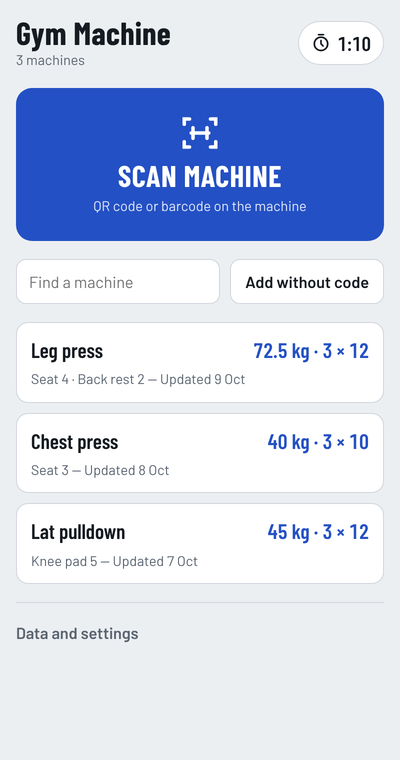
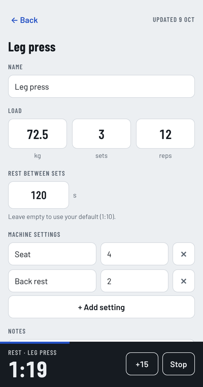

# Gym Machine

Remember settings of your gym machines and recall them via QR code and track progress.

Gym Machine is a small web app for your phone. Scan the QR code or barcode on a gym machine and it shows your saved seat and lever settings, weight, sets and reps. The first scan of a code lets you enter them; every later scan opens them straight away. It works completely offline, which helps in basement gyms with no reception.

**Open the app:** https://blablubbbb.github.io/gym_machine/

  
  

## Features

- Live scanning of QR codes and common barcodes (EAN, Code 128 and others) with the phone camera, or from a photo
- Any code works: the app only uses it to recognise the machine, whatever the code links to
- Per machine: name, weight, sets, reps, any number of settings (seat, back rest, lever …) and notes
- “Log today” keeps a history of what you lifted
- Rest timer between sets: one default rest time (90 s unless you change it), optionally a different one per machine. Vibrates and beeps when the rest is over and keeps the screen on while it counts down
- Machines without a code can be added by hand; a code can be linked to a machine later
- Works offline after the first visit and can be installed on the home screen
- German, English and Simplified Chinese (picked from the browser's preferred languages, changeable under **Data and settings**)
- Backup export and import as a JSON file

## Install on your phone (Android, Chrome)

1. Open https://blablubbbb.github.io/gym_machine/ once while you have internet.
2. Tap the ⋮ menu → **Add to home screen** (or **Install app**).
3. Start Gym Machine from the home screen. From now on it works without internet.

On iPhone, open the link in Safari → Share → **Add to Home Screen**. Live scanning of QR codes works there too; barcodes need Chrome on Android.

## Privacy

All data stays on your phone, in the browser's storage of this app. Nothing is sent anywhere: there is no server, no account, no tracking, and no fonts or scripts are loaded from other sites. The camera image is analysed on the phone and never saved or uploaded.

Because the data lives only on the phone, clearing the browser data or uninstalling the app deletes it. Use **Data and settings → Export backup** now and then.

## Deutsch

Gym Machine merkt sich die Einstellungen deiner Fitnessgeräte. Scanne den QR-Code oder Barcode am Gerät, und die App zeigt Sitz- und Hebeleinstellungen, Gewicht, Sätze und Wiederholungen, und hat einen Pausentimer zwischen den Sätzen. Sie funktioniert komplett offline. Alle Daten bleiben auf deinem Handy; es gibt keinen Server und kein Tracking.

Installieren: Link einmal mit Internet in Chrome öffnen → ⋮ → **Zum Startbildschirm hinzufügen**.

## Development

Plain HTML, CSS and JavaScript, no build step. Serve the folder with any static web server, for example `python3 -m http.server`, and open http://localhost:8000.

- `index.html`, `style.css`, `app.js` – the app
- `sw.js` – service worker that stores the app on the phone for offline use. **Raise the `CACHE` version whenever you change a file**, otherwise phones keep the old version.
- `manifest.webmanifest`, `icons/` – home screen installation
- `vendor/jsQR.js` – QR decoder for browsers without the built-in barcode scanner

To add a language, copy the `en` block in `TEXT` at the top of `app.js`, translate it, add an `<option>` to `#langSelect` in `index.html` and a date locale to `LOCALES`.

## Licenses

- Gym Machine: MIT, see [LICENSE](LICENSE)
- [jsQR](https://github.com/cozmo/jsQR) 1.4.0: Apache License 2.0, see [vendor/jsQR-LICENSE.txt](vendor/jsQR-LICENSE.txt)
- [Barlow](https://github.com/jpt/barlow) fonts: SIL Open Font License 1.1, see [fonts/OFL.txt](fonts/OFL.txt)
